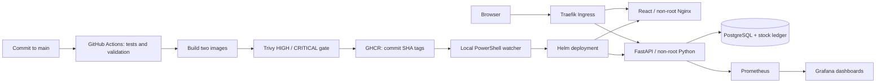

# StockPilot

[](https://github.com/piyush6805/devops_capstone_project/actions/workflows/ci-cd.yml)

[Public source](https://github.com/piyush6805/devops_capstone_project) · [Verified pipeline run](https://github.com/piyush6805/devops_capstone_project/actions/runs/38291481396) · [Backend image](https://github.com/users/piyush6805/packages/container/package/devops_capstone_project-backend) · [Frontend image](https://github.com/users/piyush6805/packages/container/package/devops_capstone_project-frontend)

An inventory dashboard with an auditable stock ledger, built for the DevOps capstone. Manage products, receive or issue stock, track adjustments, and spot low-stock items. Prices use INR. The demonstration uses fictional data and has no authentication.

The original instructor material remains under `docs/reference/`. StockPilot has its own application domain, data model, UI, test suite, and delivery configuration.

## Architecture



Docker Compose is the quickest way to run the app. A separate Kind cluster demonstrates Kubernetes. Terraform prepares real AWS VPC/EKS infrastructure as an optional second deployment path.

## Start on Windows

Requirements: Docker Desktop **running with Linux containers**. Run these commands from the project root in PowerShell:

```powershell
docker compose up --build -d --wait
docker compose exec backend python -m app.seed
```

- Application: [localhost:3000](http://localhost:3000)
- API documentation: [localhost:8000/docs](http://localhost:8000/docs)
- Liveness / readiness / metrics: `localhost:8000/health`, `/ready`, `/metrics`
- Host PostgreSQL port: **15432**; container port: 5432

Compose has a development-only password default. Copy `.env.example` to `.env` to override it before the first database initialization. Changing a password after creating a database volume does not rotate its database user. Generated Kubernetes credentials are separate.

```powershell
docker compose down             # Stop; retain database
# docker compose down --volumes # Explicitly erase the local demo database
```

## Run the checks

Install Node.js 22.12+ for host frontend checks; Python on the host is optional. Backend tests use Python 3.12 and a dedicated PostgreSQL database inside containers.

```powershell
.\scripts\test.ps1
.\scripts\scan-images.ps1
helm lint helm/stockpilot
Set-Location terraform
terraform init -backend=false
terraform validate
terraform test
Set-Location ..
```

There are 28 backend test cases, including competing withdrawals, and seven frontend component tests. Test configuration refuses a PostgreSQL database unless its name ends in `_test`. Alembic creates the test schema; tests never use `create_all`.

For an actual browser CRUD and responsive-layout check:

```powershell
Set-Location frontend
npm ci
npx playwright install chromium
npm run test:e2e
Set-Location ..
```

Set `APP_URL` to `http://stockpilot.localhost:8080` to test Kubernetes instead. Browser screenshots and scan reports go into the ignored `artifacts/` folder.

## Deploy to local Kubernetes

Requirements: Kind, kubectl, and Helm on PATH. This creates **only** the `stockpilot` Kind cluster, with context `kind-stockpilot`; scripts explicitly target it.

```powershell
.\scripts\bootstrap-local.ps1
.\scripts\deploy-local.ps1 -Commit (git rev-parse HEAD).Trim()
kubectl --context kind-stockpilot exec -n stockpilot deployment/stockpilot-backend -- python -m app.seed
```

Open [stockpilot.localhost:8080](http://stockpilot.localhost:8080). The Kind mapping binds only to localhost. If your browser does not resolve this hostname, add `127.0.0.1 stockpilot.localhost` to the Windows hosts file, or verify routing with:

```powershell
Invoke-RestMethod http://127.0.0.1:8080/api/version -Headers @{Host='stockpilot.localhost'}
kubectl --context kind-stockpilot get pods,svc,ingress,hpa,pvc -n stockpilot
helm --kube-context kind-stockpilot list -A
```

The Helm release has two frontend replicas, a backend HPA with minimum two replicas, PostgreSQL with a PVC, and one migration Job per image tag. Backend init containers wait for the migration revision. Use immutable SHA tags for updates. For repeated local-tag development, rebuild images and explicitly restart Deployments; Kubernetes does not detect a changed image behind the same tag.

Migration Jobs are regular release resources, so they can run alongside the database StatefulSet during first installation. They do not depend on a post-install hook that would deadlock Helm readiness checks. Rollback changes application images; it does not reverse database migrations. Future schema changes must remain compatible with the previous release.

## Prometheus, Grafana, and HPA

Run each port-forward in its own terminal:

```powershell
kubectl --context kind-stockpilot -n monitoring port-forward svc/monitoring-kube-prometheus-prometheus 9090:9090
kubectl --context kind-stockpilot -n monitoring port-forward svc/monitoring-grafana 3001:80
```

Open [Prometheus](http://localhost:9090/targets) and [Grafana](http://localhost:3001). Grafana user is `admin`; retrieve its generated password locally:

```powershell
$encoded = kubectl --context kind-stockpilot -n monitoring get secret stockpilot-grafana -o jsonpath='{.data.admin-password}'
[Text.Encoding]::UTF8.GetString([Convert]::FromBase64String($encoded))
```

Open the **StockPilot · application and autoscaling** dashboard. Panels show request rate, p95 latency, 5xx errors, CPU, HPA desired replicas, and available replicas. The application ServiceMonitor is enabled only after monitoring CRDs exist.

Generate real application traffic and observe scaling:

```powershell
py scripts/load-test.py --seconds 120 --workers 40
# In another terminal:
kubectl --context kind-stockpilot get hpa -n stockpilot --watch
```

Metrics Server supplies HPA CPU measurements; Prometheus supplies application dashboards. Local CPU requests are 25m to make scaling demonstrable. Allow several minutes for scaling down after load stops.

## GitHub CI and automatic local delivery

Install GitHub CLI (`winget install --id GitHub.cli --exact`) if it is not available. On the prepared workstation a portable copy is also detected from `.local/tools`.

```powershell
.\scripts\github-login.ps1
.\scripts\publish-github.ps1 -RepositoryName devops_capstone_project
```

The workflow tests PostgreSQL APIs, checks Python code, tests/builds the frontend, validates Helm and Terraform, builds both runtime images, and scans **both** with Trivy. Both scan outcomes must succeed before either image is published. Pull requests run validation without publishing images or accessing your cluster.

Both published GHCR packages were verified to allow anonymous pulls. When reproducing this setup in another repository, verify package visibility and change it to **Public** if necessary. Names are `ghcr.io/OWNER/REPOSITORY-backend` and `ghcr.io/OWNER/REPOSITORY-frontend`. Each image uses the full commit SHA, never `latest`.

```powershell
.\scripts\start-watcher.ps1
# .\scripts\stop-watcher.ps1
# Foreground mode for watching the demo output:
# .\scripts\watch-deploy.ps1 -Repository piyush6805/devops_capstone_project
```

The start script runs the watcher in the background while your computer and Docker are running; its logs and PID are saved under `.local/`. Foreground mode requires keeping its terminal open. It checks successful main runs every 60 seconds, requires their SHA to match current main HEAD, downloads the exact chart artifact, verifies repository/image metadata, deploys with bounded Helm waits, and checks `/api/version`. It saves state only after successful deployment. Failed or older runs cannot replace the deployed release. The watcher requires GitHub authentication and runs locally; no kubeconfig is uploaded to GitHub. It does not install a Windows startup task; run the start script again after reboot.

## AWS path and grading

See [AWS runbook](docs/AWS.md). Terraform creates a VPC, two public/private subnet pairs, one NAT gateway, an EKS cluster, two managed worker nodes, EBS CSI permissions, and AWS Load Balancer Controller permissions. Optional GitHub OIDC is restricted to main and Kubernetes administration in the application namespace.

**No AWS resources are provisioned by local setup or mocked tests.** The written rubric asks for actual AWS plan, VPC/EKS, and destroy evidence. Obtain the instructor's acceptance of mocking if using only the local path; do not present mock output as AWS provisioning.

## Submission and presentation

- [Rubric checklist and evidence map](docs/SUBMISSION.md)
- [Presentation walkthrough](docs/DEMO.md)
- [API contract](docs/API.md)
- [Troubleshooting](docs/TROUBLESHOOTING.md)
- [Verification record](docs/VERIFICATION.md)

```powershell
.\scripts\collect-evidence.ps1
.\scripts\package-submission.ps1
```

Keep credentials, test databases, dependency caches, and Terraform state out of the submission. Screenshots are stored separately from source control. Use meaningful commits as work progresses; do not fabricate commit history or pipeline results.

To stop the local application while retaining Compose data:

```powershell
.\scripts\cleanup-local.ps1
# .\scripts\cleanup-local.ps1 -DeleteCluster # Also erases the dedicated Kind cluster and its demo data
```
