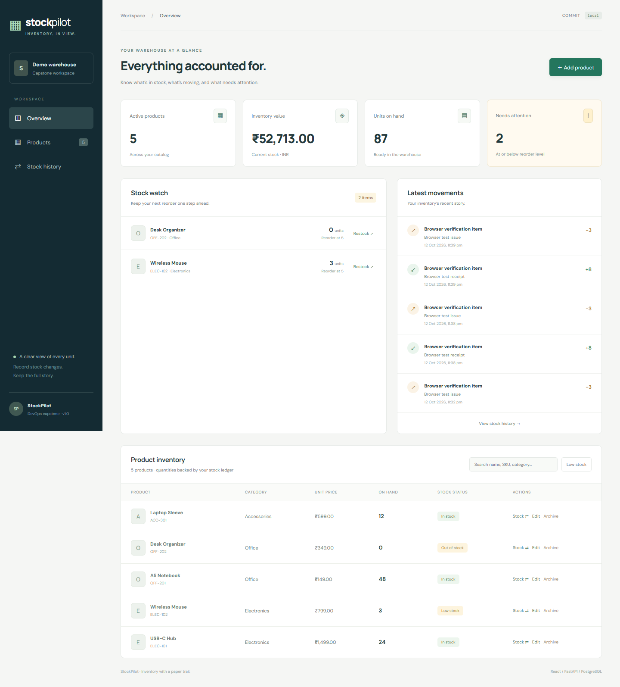
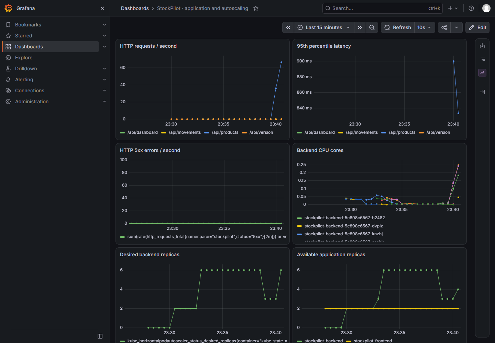
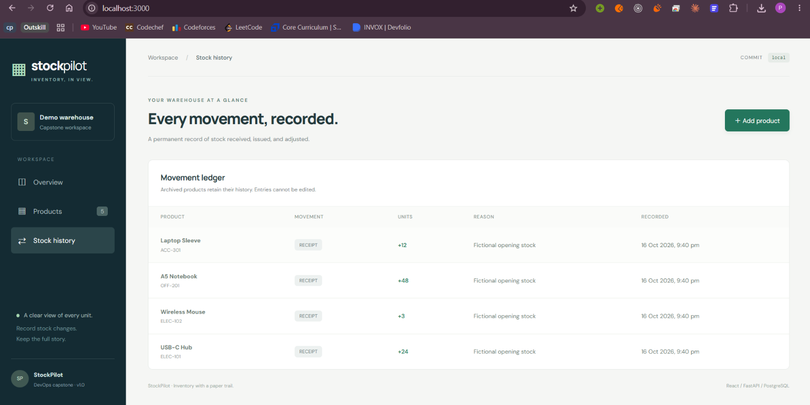
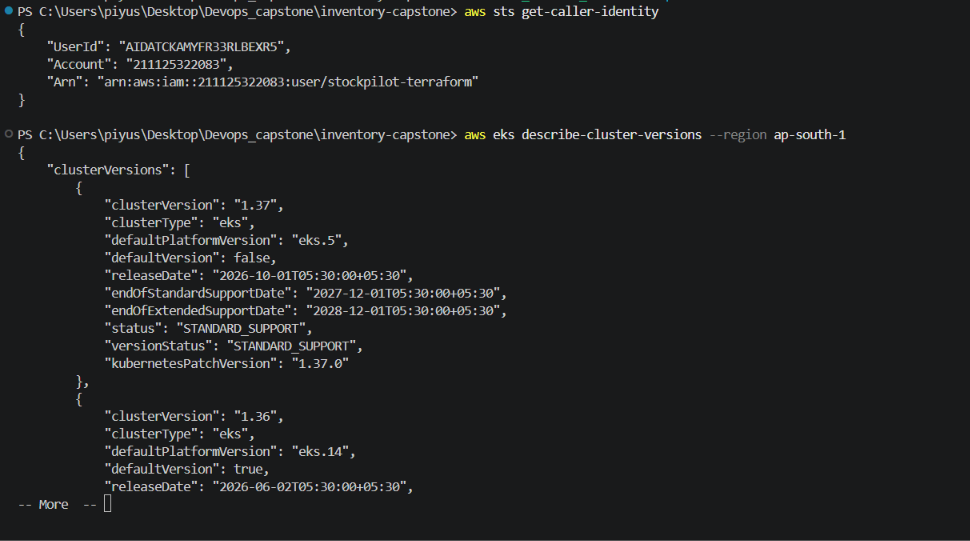
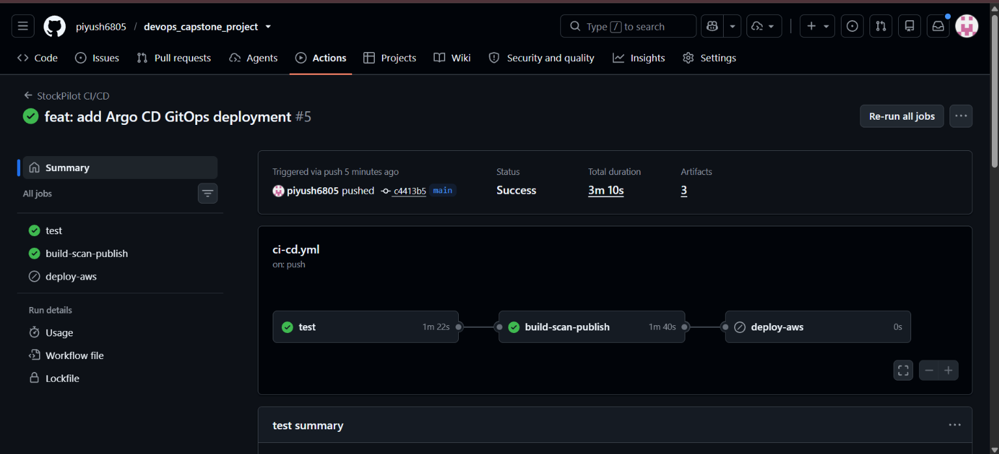
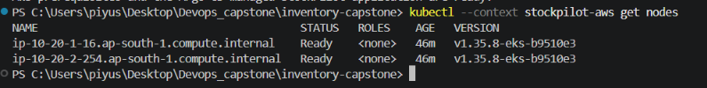
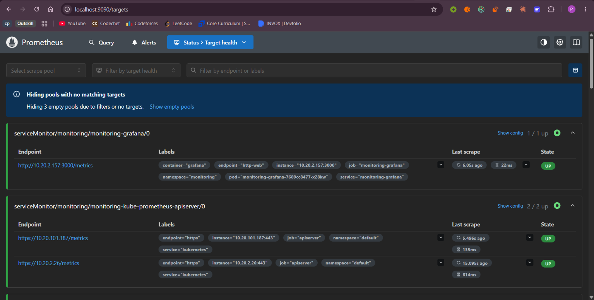
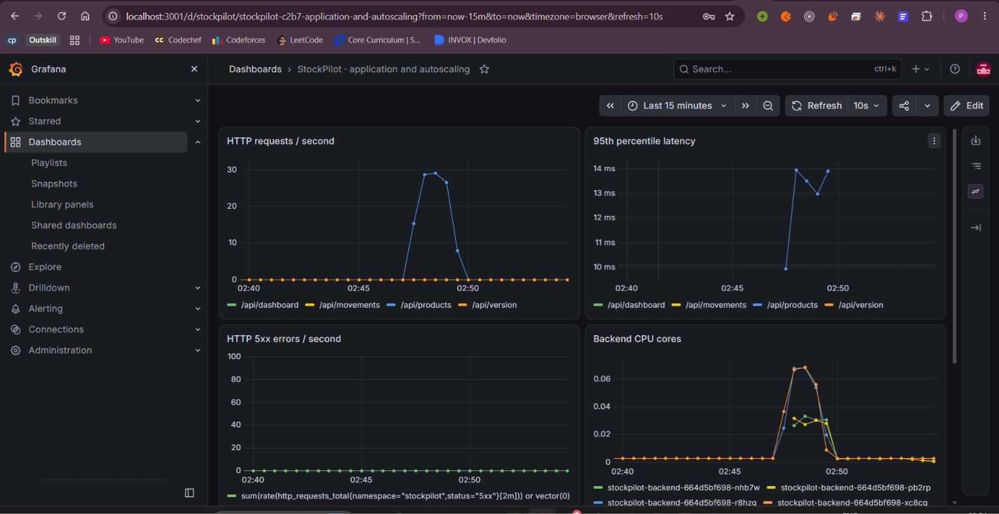

# StockPilot screenshot evidence

This page contains evidence captured from real StockPilot runs. PNG files are stored in `docs/screenshots/`. These two existing images are local verification previews; they are not AWS or ArgoCD evidence.

## Local application previews

## Fresh application and test run

## GitHub Actions and GHCR

## AWS and ArgoCD

.png)
.png)

## Kubernetes and monitoring

## AWS teardown
_Pending successful teardown; include only if AWS resources were provisioned._
